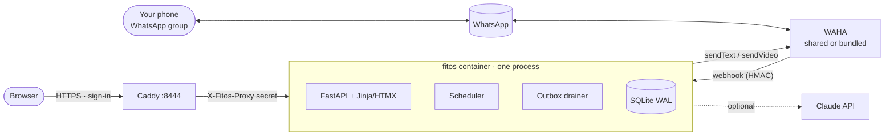

# Architecture



One container, one process: uvicorn serves the dashboard and the webhook, an in-process scheduler runs the
jobs, and an outbox drainer sends WhatsApp messages at a polite rate. SQLite in WAL mode is the only store.

## Layout

```
app/fitos/
  core/       settings, db (SQLite WAL), models, prefs (in-app settings), auth middleware, time helpers
  wa/         WAHA client (+ FakeWaha), webhook ingest, router, set parser, session flow, cards, outbox
  training/   planner, program rotation, progression, substitution, metrics, services
  labs/       biomarker ranges, overview and detail, nutrition, CSV import
  catalog/    dataset fetch, GIF → MP4 media, import, enrichment
  body/       profile, equipment profiles, body metrics
  coach/      Claude client (+ FakeLLM), tools, agent loop, prompts
  web/        routes and templates for each tab, the /dev/wa simulator
  i18n/       `_()` and `pick()`; English catalogs per area (Spanish text is the key)
  scheduler.py, jobs.py, demo.py, cli.py
catalog/      versioned data: biomarkers, program templates, equipment map, exercise enrichment
ops/          server.sh (deploy, rollback, backup), waha-webhook.sh, restore-check.sh, caddy/
deploy/       target.env.example; your target.env and local/ notes are gitignored
```

## Principles

- **Numbers come from code.** Progression, e1RM, PRs, weekly volume, substitute ranking and lab status are
  pure functions with tests. The LLM, when enabled, chooses and explains; it changes data only through
  strict, validated tools (`coach/tools.py`) and every call is logged with its cost.
- **Everything external has a double.** `FakeWaha` and `FakeLLM` make the whole app runnable and testable
  offline; `make dev` uses them.
- **Logic in services, routes stay thin.** `service.py` modules and pure modules hold the behaviour; routes
  and the WhatsApp router validate input, call, and render.

## WhatsApp pipeline

1. **Webhook** (`wa/webhook.py`): verify the HMAC-SHA512 signature → drop every chat that isn't
   `WA_GYM_CHAT_ID` *before* logging or storing anything → accept only `fromMe` messages (you write from
   your own number) → three anti-loop guards (WAHA's `source == "api"`, a registry of ids we sent, and a hash
   of the text we expect to echo back) → idempotency on the bare message id → store and process.
2. **Router** (`wa/router.py`): `ping`, `ayuda`, then the session flow.
3. **Session flow** (`wa/session_flow.py`): a small state machine (idle → plan proposed → active → finishing)
   that parses sets (`wa/parser.py`, regex first), advances exercises, offers substitutes, and closes
   sessions. Text it doesn't understand goes to the coach if enabled, or gets a short help.
4. **Outbox** (`wa/outbox.py`): every outgoing message is a row first; the drainer sends with a minimum gap
   and an hourly cap, retries, and records the WhatsApp id so the echo is recognised.

## Scheduler

`scheduler.py` keeps a list of jobs with an interval or a daily time; `job_runs` makes each run idempotent
(a restart never sends the morning plan twice). Jobs: WAHA health (5 min), session timeouts (1 min),
morning plan (daily at your hour), day close (marks missed or completed days). Nothing runs while the system
clock is before 2026 (boards without an RTC).

## Data

- `$DATA_DIR/accounts.sqlite`: who can sign in (username, bcrypt hash, role, WhatsApp group). No health data.
- `$DATA_DIR/users/<name>/fitos.sqlite`: everything one person logs, in their own database (catalog included, so
  favorites stay personal). Migrations with Alembic in batch mode (`app/migrations`), checked in CI, applied to
  every account's database by `fitos migrate`.
- One person per database is the isolation boundary: every request, WhatsApp message, scheduler run and CLI
  command runs as one user (`core/tenancy.py`, a context variable), and `core/db.py` opens that user's database.
  Without a user it raises instead of guessing.
- `$DATA_DIR/catalog/`: the downloaded dataset and generated MP4 and thumbnails (rebuildable).
- `$DATA_DIR/users/<name>/photos/`: progress photos (mode 600); `$DATA_DIR/backups/`: encrypted
  backups; `$DATA_DIR/deploy/`: deploy state.

Times are stored in UTC; calendar dates (a training day, a lab date) are in your `TZ`.

## Security model

- Dashboard: only through Caddy, trusted via `PROXY_SECRET`, then a sign-in page (accounts and bcrypt hashes in
  `$DATA_DIR/accounts.sqlite`, a signed 90-day session cookie, a brake on repeated wrong passwords); the app port is
  bound to localhost. Optional `tailscale serve` identity (listed logins are the first admin) as an alternative.
- Train (`/entreno`, `training/assist.py`): builds a day's plan from muscle groups or the program with the
  planner's ranking (place tags minus what's missing today; `smart` = first choice, `random` = one of the top
  five), edits it before and during the workout, and logs sets on the same plan and session WhatsApp uses.
- Accounts: a `user` sees only their own database; an `admin` also manages accounts (`/admin`) and can view
  anyone's dashboard read-only (cookie `fitos_view`; any write while viewing someone else is refused, except the
  admin pages, the switch and signing out).
- Webhook: HMAC-verified; containers on the shared `wa-shared` network can reach only `/healthz` and
  `/webhooks/waha` (`PEER_NET_CIDR`).
- Health data never enters git: `data/`, `.env` and backups are gitignored, imports travel by `scp`, and
  backups are encrypted to a key that isn't on the server.

The original design document, with the reasoning behind each choice, is [design.md](design.md).
