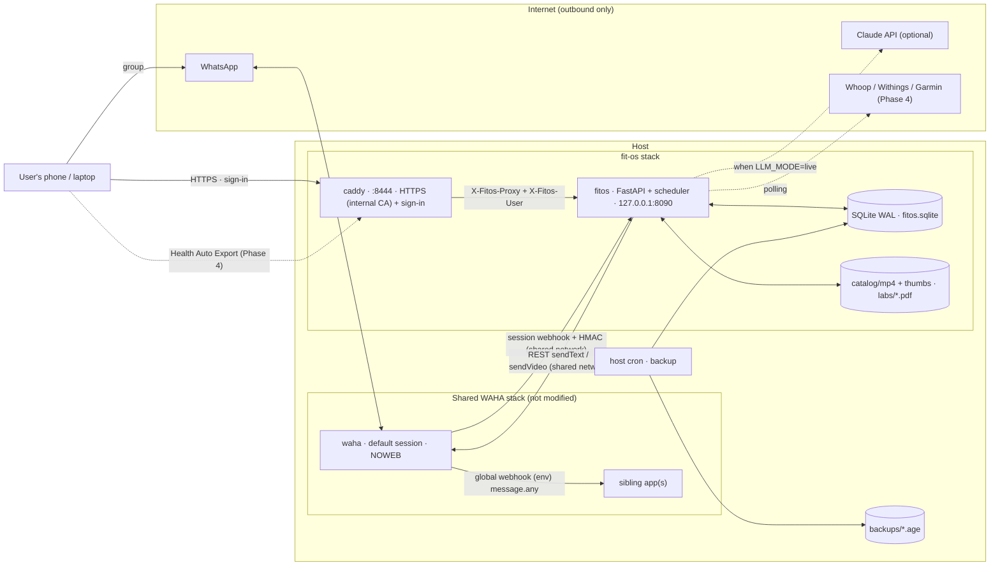

# Fit-OS — Design

> This is the original design document, translated to English and made host-agnostic. The code is the source of truth: where they disagree, the code wins.

Sources: `docs/infra-brief.md` (facts about the reference host), `docs/research.md` (datasets, WAHA, integrations, metrics, lab PDFs).

This document is for building, not for debating: every decision comes with a recommendation and its reason. Anything not verified is marked **(verify)** together with a verification step in the phase that relies on it.

## 0. Executive summary

Fit-OS is a personal training app for a single user: a WhatsApp group (e.g. "💪 Gym") where the user asks what to train today, logs every set and gets alternatives when a machine is busy, plus a web dashboard with workouts, Whoop-style progress, an exercise library, blood tests with reference bands, a chat with an AI coach, profile, integrations and settings. It runs on a small always-on host (an ARM board or any Linux box) next to other apps that share the same WAHA instance.

Key decisions:

1. **One container, one process** (`fitos`: FastAPI + scheduler on the same event loop), `mem_limit: 384m`, expected usage 150–250 MB. A single user does not justify a separate `worker` or Postgres.
2. **SQLite in WAL mode** with SQLAlchemy 2 + Alembic. Saves a container and ~120 MB, the backup is one file, and moving to Postgres would be a URL change.
3. **Python 3.12 + FastAPI + Jinja2 + HTMX + Tailwind + ECharts**, all JS/CSS pinned in `static/vendor/` (no Node and no CDN in production).
4. **Dashboard access through a Caddy sidecar** (`ops/caddy/Caddyfile`, compose profile `edge`, port 8444): HTTPS with Caddy's internal CA + `basic_auth`. The app trusts Caddy only through a shared `PROXY_SECRET` header. The app port (8090) stays on `127.0.0.1`. `tailscale serve` with identity headers remains an optional alternative (§3.5).
5. **WhatsApp through an existing WAHA instance shared with other apps (or a bundled one), without touching the sibling apps' repos or compose files**: a **session webhook dedicated to Fit-OS** is added to the `default` session; the global webhook from the environment keeps delivering to the sibling app. Verified in WAHA's source code: session webhooks and the global one **add up** (§4).
6. **The compose service is called `fitos`, never `app`**: if a sibling app receives WAHA's global webhook at `http://app:8000`, a second `app` alias on the shared network could steal it (§4.6).
7. **No polls**: the NOWEB store is off on the shared session and turning it on would persist every personal chat on disk. Numbered replies and keywords are used instead; reactions as an extra in Phase 2.
8. **Catalog `hasaneyldrm/exercises-dataset`** (1,324 exercises, 180×180 GIFs, Spanish instructions, 28 equipment values). GIF→MP4 once with ffmpeg; Spanish names, movement pattern, station and requirements are generated once with Claude and versioned in `catalog/enrichment.json`.
9. **Numbers are code; the LLM chooses and explains**: set parser, progression, e1RM, PRs, metrics, substitute ranking and lab status are deterministic, tested functions. The LLM only mutates data through validated tools; structural changes require confirmation.
10. **The coach is optional and off by default** (`LLM_MODE=off`): everything else is deterministic and works without an API key. When enabled it uses `claude-opus-5-5` (effort `low` live, `medium` for planning) with `strict` tools, structured outputs and prompt caching; `claude-haiku-5-5` only as a parser fallback. The happy path of a gym session never calls the LLM: it answers in under a second.
11. **Labs**: a canonical biomarker dictionary with three kinds of range (lab standard by sex and age, borderline, user target), and charts that draw band + target line. Seeded from a CSV export of historical results.
12. **Health data stays out of git**: `data/` is in `.gitignore`; on the host it lives in `$DATA_DIR`; backups encrypted with `age`; no health values in logs or fixtures.
13. **Development without touching production**: locally WAHA and Claude are replaced by `FakeWaha` and `FakeLLM`, and the `/dev/wa` page simulates the group.
14. **Cost**: USD 0 of infrastructure; with the coach on, Claude ≈ USD 5–15/month with a configurable daily cap.

## 1. Scope

### 1.1 What was asked and where it lands

| Requirement | Where | Phase |
|---|---|---|
| App connected to a WhatsApp chat, deployed on the host | Dedicated group via shared WAHA (§4) | 0 |
| Web dashboard | 9 tabs (§12) | 0–1 |
| Labs: blood + nutrition, charts over time with sex/age limits, and a personal target when stricter | **Labs** tab (§9) | 1 |
| Future lab PDFs: upload and extract | Labs → Upload PDF (§9.4) | 3 |
| Exercise log | **Workouts** tab | 1 |
| Ask or receive "today is legs / chest / this combination" | `hoy` in WhatsApp + proactive morning message (§7.2) | 1 |
| Personal-info tab for the AI | **Profile** tab (goals, injuries, schedule, experience, measurements) | 1 |
| (1) Reps and weight per exercise + progressive overload | Live session (§7.3–7.5) | 1 |
| (2) Video or animation for each exercise | MP4 clip on the exercise card (§6) | 1 |
| (3) Configurable equipment; alternative when missing or busy | Equipment profiles + substitution (§6.3, §7.6) | 1 |
| (4) Exercise library with videos and muscle groups | **Exercises** tab | 1 |
| (5) AI chat about the program; configurable program | **Coach** and **Settings** tabs (§8) | 1 (v0) · 2 |
| (6) Integrations: Apple Health, Whoop, Garmin… | **Integrations** tab (§11) | 1 (skeleton) · 4 |
| (7) Whoop-style progress/performance | **Progress** tab (§10) | 1 · 2 |

### 1.2 Proposed ideas

| Idea | Why it is worth it | Phase |
|---|---|---|
| PR celebration in the chat | Almost free once e1RM exists; motivating | 1 |
| **Today** tab as home page | One screen with the session, the week and alerts | 1 |
| Morning readiness check-in (sleep, energy, soreness: `4 3 2`) | Adjusts the day's volume without a wearable | 2 |
| Rest timer over WhatsApp | Ping when rest ends, with the next target | 2 |
| Body weight and measurements by chat (`peso 80.4`) | Trend with moving average; feeds nutrition targets | 2 |
| Weekly report over WhatsApp (Sunday) | Volume per muscle, PRs, consistency, next week's focus | 2 |
| Quick logging from the web | Fallback if WAHA goes down mid-session | 2 |
| Deload suggestion | Rules from `research.md` §4 on e1RM, RPE and load | 2 |
| Nutrition targets derived from weight, goal and labs | Protein, calories and guidelines per off-target marker | 3 |
| Next-lab-test reminder | Typical cadence is ~4–5 months | 3 |
| Voice note set logging, progress photos, plate calculator, cardio, CSV export | Useful but not critical | 5 |

### 1.3 Out of scope

Multi-user, native app, public internet access, medical diagnosis or medication/supplement dosing, calorie counting from photos, social features, and anything that requires a second WAHA or a second phone number.

## 2. Assumptions and open questions

### 2.1 Working assumptions

- The host can spare ~400 MB more (Fit-OS + Caddy). Small ARM boards with a few GB of RAM shared with other services are the target; the loopback app port (8090) and the edge port (8444) are configurable (`APP_PORT`, `EDGE_PORT`) to avoid clashes with sibling apps.
- An external Docker network shared with WAHA exists (`WA_NETWORK`, default `wa-shared`) and the `waha` container is attached to it. The operator copies the WAHA API key into Fit-OS's `.env`. It is never printed.
- The only person writing in the group is the user, from the session's own number, so their messages arrive as `fromMe`.
- The host runs in UTC and may **lack an RTC battery** (common on small boards): after a power cut it boots believing it is the year 2000 until NTP syncs. The scheduler fires nothing while the clock reads earlier than 2026.
- The chat and UI are in Spanish (the original target user); identifiers, tables and file names are in English. See `CLAUDE.md` for current conventions.

### 2.2 Open questions (each with its default)

| # | Question | Blocks | Default |
|---|---|---|---|
| 1 | May the Fit-OS webhook be added to WAHA's `default` session? The `PUT` restarts the session for a few seconds (sibling apps cannot send during that window). | Phase 0 echo | Yes, at a quiet hour, with `ops/waha-webhook.sh` and a one-command rollback (§4.5) |
| 2 | Create the group from the phone (WhatsApp requires a second participant at creation; they can be removed afterwards). | Phase 0 echo | Until it exists, work with the `/dev/wa` simulator |
| 3 | Anthropic API key for Fit-OS. | Catalog enrichment and coach | A dedicated key, to see its spend separately. The coach stays off (`LLM_MODE=off`) without one |
| 4 | Ambiguous cells in the seed lab CSV (a value written in another marker's cell; a target defined at a different time point than the measured value). | Nothing | Import with `needs_review`, or draw the target with an explicit label (§9.2) |
| 5 | Which devices does the user have (Whoop, Apple Watch/iPhone, Garmin, Withings scale)? | Phase 4 | Order from `research.md`: Whoop → Health Auto Export → Withings → Garmin |
| 6 | Opus 5.5 for the coach (≈ USD 5–15/month)? | Nothing | Off by default; when enabled, Opus, switchable via `.env` (`LLM_COACH_MODEL`) |

Training days, goal, injuries and exact home equipment are not questions: they are filled in the **Profile** wizard the first time the dashboard is opened.

## 3. Architecture and stack

### 3.1 Where it runs and budget

Everything on the host; data in `$DATA_DIR` (ideally on fast local storage, outside the repo). Internet is outbound only (Claude when enabled, and in Phase 4 Whoop/Withings/Garmin); inbound only through the Caddy edge port and the shared Docker network.

| Piece | Steady RAM | Peak | Limit |
|---|---|---|---|
| `fitos` (uvicorn, 1 worker, scheduler inside) | 150–250 MB | ~320 MB extracting a PDF | `mem_limit: 384m` |
| `caddy` (edge profile) | ~20–30 MB | — | `mem_limit: 64m` |
| `docker compose run --rm fitos fitos catalog build-media` (once) | — | ~200 MB + ffmpeg | `--memory 512m`, transient |
| **Fit-OS total** | **≈ 0.25 GB** | < 0.6 GB | target ≲ 600 MB met |

### 3.2 Diagram



### 3.3 Compose services

```yaml
name: fit-os
services:
  fitos:                      # NEVER "app" (§4.6)
    build: ./app
    image: fit-os/app:local
    container_name: fit-os
    restart: unless-stopped
    env_file: .env
    environment:
      DATA_DIR: /data
      TZ: ${TZ}
      GIT_SHA: ${GIT_SHA:-dev}
    command: ["uvicorn", "fitos.main:app", "--host", "0.0.0.0", "--port", "8000", "--no-proxy-headers"]
    ports: ["127.0.0.1:${APP_PORT:-8090}:8000"]   # local ops only; the entry point is caddy
    volumes:
      - ${DATA_DIR:-./data}:/data
      - ./catalog:/catalog:ro                     # biomarkers, templates, enrichment (versioned)
    healthcheck: {test: ["CMD", "python", "-c", "import urllib.request,sys; sys.exit(0 if urllib.request.urlopen('http://localhost:8000/healthz').status==200 else 1)"], interval: 30s, timeout: 5s, start_period: 20s, retries: 3}
    mem_limit: 384m
    networks: [default, wa]

  caddy:
    image: caddy:2-alpine
    container_name: fit-os-caddy
    profiles: [edge]                              # COMPOSE_PROFILES=edge on the host; `make dev` skips it
    restart: unless-stopped
    depends_on: [fitos]
    environment: {PROXY_SECRET: ${PROXY_SECRET:-}}
    ports: ["${EDGE_PORT:-8444}:8444"]
    volumes:
      - ./ops/caddy/Caddyfile:/etc/caddy/Caddyfile:ro
      - ${DATA_DIR:-./data}/caddy/users.caddy:/etc/caddy/users.caddy:ro
      - caddy_data:/data
    mem_limit: 64m
    networks: [default]                           # not on the shared WAHA network
volumes:
  caddy_data: {}
networks:
  default: {}
  wa: {name: "${WA_NETWORK:-wa-shared}", external: true}
```

Rules: a single uvicorn worker (the scheduler lives inside; two workers would duplicate jobs); the app port only on `127.0.0.1`; only Caddy listens on a host-reachable port; `docker-compose.dev.yml` adds `--reload`, mounts the code and sets `WAHA_MODE=fake`, `LLM_MODE=fake`, `DEV_USER_LOGIN`.

### 3.4 Stack and why

| Piece | Choice | Reason (one line) |
|---|---|---|
| Language and web | Python 3.12, FastAPI, uvicorn | Boring, well known; arm64 is trivial |
| UI | Jinja2 + HTMX + Tailwind + ECharts, in `static/vendor/` with pinned versions | No Node build; ECharts has `markArea`/`markLine` for lab bands |
| Data | SQLite (WAL, `busy_timeout=5000`, `foreign_keys=ON`) + synchronous SQLAlchemy 2 + Alembic (`render_as_batch=True`) | One user, < 100k rows/year; less RAM and a one-file backup |
| Jobs | Own asyncio loop (`scheduler.py`): every 5 s fires due `timers` and evaluates daily jobs against `job_runs` | Schedules live in `settings` and change live; persistent; testable as the pure function `due_jobs(now, settings, last_runs)` |
| WhatsApp | `httpx` against the shared WAHA; outbox with a single drainer | Send + receive on one client |
| LLM | `anthropic` SDK (`AsyncAnthropic`), manual tool loop | Control over validation and confirmations without depending on the beta tool runner |
| Secrets in the DB | Fernet (`cryptography`) with `SECRETS_KEY` | Per-column encryption of integration OAuth tokens |
| Media | ffmpeg (apt, inside the image) | One image for amd64 and arm64; the binary costs no RAM when idle |
| Edge | Caddy 2 (alpine) | HTTPS with an internal CA in front of the app's sign-in in a ~30 MB container |
| Quality | pytest + ruff (`line-length = 110`), GitHub Actions | |

### 3.5 Access

- **Default: Caddy sidecar** (`ops/caddy/Caddyfile`, compose profile `edge`, set `COMPOSE_PROFILES=edge` in the host's `.env`). It listens on `:8444` with `tls internal` (`on_demand`), so the browser sees Caddy's local CA (trust its root or accept the warning once). `basic_auth` users live outside the repo in `$DATA_DIR/caddy/users.caddy`, one `user <bcrypt hash>` per line (hash with `docker run --rm caddy:2-alpine caddy hash-password --plaintext '…'`, then `docker compose restart caddy`).
- Caddy forwards to `fitos:8000` with `header_up X-Fitos-Proxy {$PROXY_SECRET}` and `header_up X-Fitos-User {http.auth.user.id}`. `header_up` overwrites any value the client sent, so a client cannot inject either header.
- `core/auth.py`: a request is trusted as coming from Caddy only if `X-Fitos-Proxy` matches `PROXY_SECRET` (constant-time comparison; empty secret = no proxy is trusted). The user then comes from `X-Fitos-User`. Without the secret the user header is worthless. Covered by `test_auth.py`.
- `PORTAL_BASE_URL` (used for links in messages) is the address users actually open, e.g. `https://<host>:8444`. Use the host's IP or short name: with a `*.ts.net` hostname Caddy asks tailscaled for the certificate and TLS fails.
- **Source IP cannot be used for authorization**: with a published Docker port, docker-proxy replaces the client address with the bridge gateway's, so every request looks like it comes from the same internal IP.
- **Optional alternative: `tailscale serve`** in front (`tailscale serve --bg --https 8444 http://127.0.0.1:8090`), with `TRUST_TAILSCALE_HEADERS=true`: the `Tailscale-User-Login` header must be in `OWNER_LOGINS` (empty = nobody), otherwise 403. Keep `TRUST_TAILSCALE_HEADERS=false` unless `tailscale serve` really is in front: without it, anyone who reaches the app can forge that header.
- In development, `DEV_USER_LOGIN` (ignored when `APP_ENV=production`).
- Paths without identity: only `/healthz` and `/webhooks/waha` (the latter requires HMAC). The WAHA webhook does not go through Caddy; it reaches `fitos:8000` directly on the shared network.
- Hardening against neighbours on the shared WAHA network (they could forge headers): a middleware restricts any request arriving through that network's interface (`scope["server"]` or the client address within `PEER_NET_CIDR`, written to `.env` from `docker network inspect`) to `/healthz` and `/webhooks/waha`. Caddy is deliberately not on that network.
- Discarded: binding the app directly to a VPN interface address (the container fails to start if the VPN comes up after Docker, and there is no HTTPS or identity).

### 3.6 Discarded

Postgres and a separate `worker` (weight without benefit for one user), wger or Liftosaur (pre-planned routines clash with a day-by-day coach; `research.md` §5), a Node SPA, APScheduler (schedules change live from Settings), a second WAHA (+400–500 MB), WhatsApp polls, Strava and Google Fit (`research.md` §3).

## 4. WhatsApp over the shared WAHA

### 4.1 Decision

**Add to the `default` session a session webhook that points only to Fit-OS and leave the global webhook untouched** (`WHATSAPP_HOOK_URL`, which delivers to a sibling app, e.g. `http://app:8000/webhook`).

Basis, read in WAHA's source (`core` branch) at design time:

- `src/modules/waha-webhook/WebhookPlugin.ts`, method `webhooks()`, commented *"Session webhooks + the predefined one (WHATSAPP_HOOK_URL)"*: it concatenates `sessionConfig.webhooks` and the global one. **Both fire.** That is why re-declaring the sibling app's URL in the session would duplicate every message for it.
- `src/core/manager.core.ts`: the session config is persisted (`sessionConfigRepository.saveConfig`) and, with `WHATSAPP_RESTART_ALL_SESSIONS=True` in WAHA's environment, reloaded when the container restarts. The webhook survives restarts.
- `WebhookPlugin.sender.ts`: one independent sender per URL, HMAC `sha512` in `X-Webhook-Hmac`, 15 retries every 2 s by default. If Fit-OS is down, the sibling app does not notice.

The reference host ran WAHA 2026.7.2 and the reading was of the current branch: the verification in §4.4 confirms the behaviour on the deployed version before relying on it.

If Fit-OS runs its own bundled WAHA instead (compose profile `waha`, no siblings), WAHA's global webhook (`WHATSAPP_HOOK_URL=http://fitos:8000/webhooks/waha`, events `message.any,session.status`, HMAC from `WAHA_WEBHOOK_HMAC_KEY`) points at Fit-OS and `WAHA_HOOK_MODE=global` tells the health check not to look for a session webhook.

### 4.2 Options evaluated

| Option | Verdict |
|---|---|
| (a) `PUT` with both URLs in `config.webhooks` | No: the global one adds up, the sibling would receive every event twice |
| **(a′) `PUT` with only the Fit-OS URL; global left as is** | **Chosen**: zero changes to the sibling's repo, compose and `.env`; own events and HMAC key; one-`PUT` rollback |
| (b) Remove `WHATSAPP_HOOK_URL` from the sibling's compose and declare both in the session | No: recreates the WAHA container and touches a production service for no gain |
| (c) Have the sibling app forward other chats | Plan C: couples Fit-OS to the sibling's deploys and outages and puts fitness code in an unrelated repo |
| (d) Second session or second WAHA | No: +400–500 MB, and with a second session in the same container the global webhook would duplicate everything to the sibling |
| (e) Poll chat messages | No: requires the NOWEB store |

### 4.3 Exact steps

Run by `ops/waha-webhook.sh` on the host (reads `WAHA_API_KEY`, `WAHA_SESSION` and `WAHA_WEBHOOK_HMAC_KEY` from Fit-OS's `.env` without printing them; talks to WAHA on the host's loopback). Subcommands: `show` (config with keys masked), `add`, `remove`, `restore <file>`. Exposed as `make waha-hook ACTION=show|add|remove`; mutations require `CONFIRM=1`.

1. Prerequisites: Fit-OS deployed and healthy; the host's `.env` with `WAHA_API_KEY` (copied by the operator), `WAHA_WEBHOOK_HMAC_KEY` (`openssl rand -hex 32`, new, different from any sibling's key) and the group created.
2. Check from WAHA that Fit-OS answers and that `app` still resolves only to the sibling (inside the WAHA container use `node -e`; do not assume curl):
   ```bash
   docker exec waha node -e "fetch('http://fitos:8000/healthz').then(r=>console.log(r.status))"            # 200
   docker exec waha node -e "require('dns').lookup('app',{all:true},(e,a)=>console.log(a))"                # a single IP
   ```
3. Get the group id: the `wa-groups` Makefile target runs `fitos wa groups --match Gym` → `<id>@g.us  💪 Gym`; put it in `WA_GYM_CHAT_ID` and restart `fitos`.
4. Save the previous state: `ops/waha-webhook.sh show --raw > $DATA_DIR/deploy/waha-session-before.json` (`chmod 600`).
5. At a quiet hour, `CONFIRM=1 ops/waha-webhook.sh add`:
   - `GET /api/sessions/default`; abort if `status != "WORKING"`.
   - Build `config' = config` (without `null` fields) with `webhooks = [w for w in config.webhooks if w.url != FITOS_URL] + [new]`, where `new = {"url": "http://fitos:8000/webhooks/waha", "events": ["message.any", "session.status"], "hmac": {"key": "<WAHA_WEBHOOK_HMAC_KEY>"}}`. Idempotent, and preserves the rest of the config: the `PUT` replaces it entirely.
   - `PUT /api/sessions/default` with `{"config": config'}`; wait up to 90 s for `WORKING`; print the config with keys masked.
6. Run the verification in §4.4. If any point fails, roll back (§4.5).

### 4.4 Verification

| # | Test | Expected result |
|---|---|---|
| a | `ops/waha-webhook.sh show` | `status: WORKING`, exactly one session webhook (Fit-OS's) |
| b | Write `ping` in the group from the phone | A single reply `pong · Fit-OS <sha>`; `fitos wa stats`: `processed +1`, `own_echo_ignored +1`, `duplicates 0` |
| c | `docker logs --since 1m waha 2>&1 \| grep 'Sending POST'` after that `ping` | For each `message.any` event (the `ping` and the `pong` are two), exactly two lines with the same `event.id`: one to the sibling's URL and one to `fitos:8000/webhooks/waha`. If the sibling stopped receiving, or receives twice: roll back |
| d | A normal interaction with each sibling app on its own chat | It answers once, as always; no `invalid HMAC` in its logs |
| e | A message in any other personal chat | `fitos wa stats`: `dropped_foreign +1`; `select count(*) from wa_messages where chat_id != :gym` = 0; no foreign body in `docker logs fit-os` |
| f | (Recommended, once, same window) `docker restart waha` and repeat a–b | The session webhook is still there |
| g | Check that each sibling app is restricted to its own chats (e.g. an allow-list of chat ids) | It ignores the new group instead of "answering everything" |

### 4.5 Rollback

- `CONFIRM=1 ops/waha-webhook.sh remove`: `PUT` with the config without the Fit-OS URL (back to `webhooks: []` if it was empty). Restarts the session for a few more seconds.
- If the config ended up odd: `CONFIRM=1 ops/waha-webhook.sh restore $DATA_DIR/deploy/waha-session-before.json`.
- If the session does not come back to `WORKING`: restart it from WAHA's dashboard or API (or from a sibling app's admin page, if it has one); if it asks for a QR, re-link as with any session drop. A config `PUT` does not log the session out, so this is unlikely.
- Before shutting Fit-OS down for more than a few minutes: remove the webhook first, so WAHA does not pile up failed retries in its log.
- If on the deployed version the global webhook stopped firing when session webhooks exist (contradicting the code read): `remove`, and switch to option (a), reading the sibling's key inside the script (`docker exec waha printenv WHATSAPP_HOOK_HMAC_KEY`) without printing it.

### 4.6 Receiving: filter, `fromMe`, loops, HMAC

`POST /webhooks/waha` does, in this order and in under 100 ms:

1. **HMAC**: `X-Webhook-Hmac` = HMAC-SHA512 of the raw body with `WAHA_WEBHOOK_HMAC_KEY`, constant-time comparison; in production the app refuses to start without a key. Failure → 401.
2. **Chat filter, before any log or write**: for `message.any`, if `payload.from != WA_GYM_CHAT_ID` → 200 and an in-memory counter. **All** of the user's personal chats pass through this webhook: they are never logged or persisted. (`session.status` has no chat and goes to its own handler.)
3. **Owner only**: `payload.fromMe == true` is required. If someone else ever joins the group, their messages are ignored.
4. **Anti-loop, three guards** (Fit-OS's own messages also come back as `fromMe`):
   - `payload.source == "api"` → it was sent through WAHA's API, not from the phone **(verify in Phase 0 that NOWEB on the deployed version includes the field)**;
   - the id (normalised as `bare_id`: `true_<chat>_<id>[_<participant>]` → `<id>`) is in `wa_messages` as outgoing;
   - "expected echo": before each send a hash of chat+text is recorded with a 30 s lifetime; an incoming `fromMe` that matches is our own. Covers the race in which the echo arrives before the HTTP response of the send.
5. **Idempotency**: `wa_messages.wa_id` is unique; a duplicate returns 200 without reprocessing.
6. Insert the `received` row, return 200 and process in the background under a global `asyncio.Lock`: messages are handled one at a time and in order, with no races in the state machine. On startup, `received` rows younger than 10 minutes are reprocessed; older ones become `stale` without a reply.

A `session.status` other than `WORKING` is shown in Settings → Health. A job every 5 minutes calls `GET /api/sessions/default`: if the Fit-OS webhook is no longer in `config.webhooks`, a red card and a message to the group (sending still works) asking to re-run `make waha-hook ACTION=add`. No self-repair: an automatic `PUT` could interrupt a QR re-link.

**Naming trap**: Docker registers the service name as a DNS alias on every network the container joins. WAHA sits on the sibling's internal network and on the shared network, and delivers the global webhook to `http://app:8000`. If the Fit-OS service were called `app`, that alias would also exist on the shared network and WAHA could deliver the sibling's events to Fit-OS. Hence `fitos`, and hence the DNS check in step 2. Avoid `worker`, `db` and `waha` too.

### 4.7 Sending

- `wa/client.py` (`httpx.AsyncClient`, `X-Api-Key`, 20 s timeout; 120 s for media): `send_text` → `POST /api/sendText`; `send_video` → `POST /api/sendVideo` with `{file: {mimetype: "video/mp4", filename, data: <base64>}, caption, asNote: false, convert: false}`; `send_image`; `start_typing`/`stop_typing`; `session_status`; `groups` (NOWEB answers a dict keyed by id; normalise it into a list).
- **Media as base64, not by URL**: clips weigh 30–150 KB; this way WAHA never needs a media route into Fit-OS.
- **Outbox** (`wa_messages` with `direction='out'`, `queued → sent | failed`): one drainer, 0.8 s between sends, `WA_MAX_PER_HOUR=120`, up to 3 retries with backoff. The number is the user's personal one: low volume, no bursts, and the set confirmation and the next target travel in a single message.
- The clip is sent the first time the user does an exercise, and whenever they write `video` (setting `clip_policy`: `first_time` | `always` | `on_demand`).
- **(verify in Phase 1)** that an MP4 without audio plays on the phone; if not, the pipeline adds a silent track (`-f lavfi -i anullsrc -shortest -c:a aac`).

### 4.8 Polls: no

`sendPoll` needs the NOWEB store to decrypt votes. Turning it on in the shared session would persist contacts and messages from every personal chat on the host and may require re-linking the session the sibling apps depend on. Every choice is resolved with **numbered replies and keywords** ("1 Empezar · 2 Cambiar a casa · 3 Otro enfoque · 4 Descanso"). In Phase 2 `message.reaction` is added (a thumbs-up on the plan = start) if the event is confirmed to arrive for own reactions on this engine.

## 5. Data model

Conventions: autoincrement integer ids except `exercises.id` (dataset id, text) and single-row tables; `created_at`/`updated_at` in UTC; "calendar" dates (`date`) in the configured local timezone (`TZ`); SQLAlchemy JSON columns; fixed constraint naming convention for Alembic in batch mode. Phase 2–4 tables are created in the phase that uses them.

| Table | Key columns | Notes |
|---|---|---|
| `settings` | `key` PK, `value` JSON | `morning_hour`, `quiet_hours`, `rest_seconds`, `clip_policy`, `weekly_report_day`, `llm_daily_budget_usd`, toggles |
| `profile` (1 row) | `sex`, `birth_date`, `height_cm`, `experience` (`beginner\|intermediate\|advanced`), `primary_goal` (`hypertrophy\|strength\|fat_loss\|recomp\|health`), `goal_notes`, `days_per_week`, `session_minutes`, `schedule` JSON (day → `{equipment_profile_id, time}`), `injuries` JSON (`[{area, severity, since, notes}]`), `disliked_exercise_ids` JSON, `coach_notes` | Seeded from `data/import/profile.yaml` |
| `equipment_profiles` | `name`, `kind` (`home\|gym`), `is_default`, `tags` JSON, `loads` JSON (`{dumbbell_kg: [...], barbell_step_kg, machine_step_kg}`) | §6.3 |
| `exercises` | `id` PK, `name_en`, `name_es`, `primary_muscle`, `secondary_muscles` JSON, `equipment_raw`, `equipment_tag`, `requires` JSON, `station`, `movement_pattern`, `mechanic`, `laterality`, `load_kind`, `stress_joints` JSON, `is_staple`, `difficulty`, `instructions_es` JSON, `media_mp4`, `media_thumb`, `attribution`, `enabled`, `favorite`, `custom` | §6 |
| `programs` | `name`, `split_kind`, `days_per_week`, `status` (`active\|archived\|proposed`), `config` JSON (rep ranges, target RIR, weekly sets per muscle, `deload_every_weeks`), `created_by` (`template\|llm\|user`), `started_on` | One active |
| `program_days` | `program_id`, `order_idx`, `name`, `focus` JSON, `slots` JSON (`[{slot, pattern, muscle, sets, rep_min, rep_max, target_rir, preferred_exercise_ids}]`) | Rotation by order, not by weekday |
| `planned_sessions` | `date`, `program_day_id`, `focus_label`, `equipment_profile_id`, `status` (`proposed\|accepted\|active\|completed\|skipped\|replaced`), `rationale`, `source` (`planner\|llm\|user`) | One current per date |
| `planned_items` | `planned_session_id`, `order_idx`, `exercise_id`, `sets`, `rep_min`, `rep_max`, `target_rir`, `target_weight_kg`, `status` (`pending\|active\|done\|skipped\|swapped`), `swapped_from_id`, `swap_reason`, `note` | The target is frozen at planning time |
| `workout_sessions` | `planned_session_id`, `date`, `started_at`, `ended_at`, `equipment_profile_id`, `state`, `session_rpe`, `notes`, `source` (`wa\|web`), `wa_context` JSON (current item and set, busy stations, excluded tags, alternatives cursor) | §7.3 |
| `workout_sets` | `session_id`, `planned_item_id`, `exercise_id`, `set_idx`, target (`target_rep_min`, `target_rep_max`, `target_weight_kg`, `target_rir`), performed (`reps`, `weight_kg`, `rir`, `duration_s`), `is_warmup`, `e1rm_kg`, `pr_flags` JSON, `raw_text`, `logged_at` | Target vs performed, like wger |
| `prs` | `exercise_id`, `kind` (`e1rm\|weight\|reps_at_weight`), `value`, `set_id`, `achieved_on` | Recomputable from `workout_sets` |
| `body_metrics` | `measured_at`, `kind` (`weight_kg\|body_fat_pct\|waist_cm\|…`), `value`, `source` | Unique `(kind, measured_at, source)` |
| `daily_checkins` (P2) | `date` PK, `sleep_quality`, `sleep_hours`, `soreness`, `energy`, `stress`, `readiness_score` | |
| `biomarkers` | `key` PK, `name_es`, `name_en`, `loinc`, `category`, `canonical_unit`, `unit_conversions` JSON, `aliases` JSON, `direction` (`lower\|higher\|range`), `derived_from` JSON, `decimals`, `sort_order` | Seeded from `catalog/biomarkers.yaml` |
| `biomarker_ranges` | `biomarker_key`, `kind` (`lab_standard\|borderline\|user_target`), `sex` (`male\|female\|any`), `age_min`, `age_max`, `low`, `high`, `label`, `source` | §9.1 |
| `biomarker_notes` | `biomarker_key` PK, `food_positive` JSON, `food_negative` JSON, `raw` | `notes` column of the seed CSV |
| `lab_reports` | `collected_on`, `date_precision` (`day\|month`), `lab_name`, `source` (`seed_csv\|pdf\|manual`), `file_path`, `file_sha256` unique, `status` (`confirmed\|needs_review`), `extraction` JSON | |
| `lab_results` | `report_id`, `biomarker_key`, `collected_on`, `value_num`, `value_text`, `comparator`, `unit`, `value_canonical`, `ref_low`, `ref_high`, `ref_text`, `flag`, `page`, `raw_name`, `needs_review`, `note` | Unique `(biomarker_key, report_id)`; `ref_*` is the range printed by that lab |
| `wa_messages` | `wa_id` unique, `direction`, `from_me`, `source`, `kind`, `body`, `quoted_wa_id`, `status`, `handler`, `error` | Only the Fit-OS group; inbound and outbox |
| `chat_threads` | `channel` (`wa\|web`), `title`, `day`, `closed_at` | One per day on WhatsApp; one per conversation on the web |
| `chat_messages` | `thread_id`, `seq`, `role`, `content` JSON | The exact blocks sent to and received from the API, to replay them unedited (§8.4) |
| `llm_calls` | `purpose`, `model`, tokens (`input`, `output`, `cache_read`, `cache_write`), `cost_usd`, `latency_ms`, `stop_reason` | Budget and cache diagnostics |
| `pending_actions` | `kind`, `payload` JSON, `status`, `expires_at` | Structural changes waiting for a "yes" |
| `audit_log` | `actor` (`user\|llm\|system`), `tool`, `entity`, `entity_id`, `before` JSON, `after` JSON | Enables `deshacer` (undo) |
| `integrations`, `integration_secrets`, `external_samples` (P4) | provider, status, cursor; Fernet blob; `(provider, kind, external_id)` unique with `start_at`, `end_at`, `value_num`, `payload` | §11 |
| `timers`, `job_runs` | `due_at`, `kind`, `payload`, `status`; `(job, period_key)` PK | Persistent, idempotent scheduler |

## 6. Exercise catalog

### 6.1 Dataset

`hasaneyldrm/exercises-dataset`: `data/exercises.json` (17.4 MB, 1,324 records), `videos/<id>-<media_id>.gif` and `images/<id>-<media_id>.jpg` (180×180). Fields: `id`, `name` (**English only**), `target` (19 values), `secondary_muscles` (40 distinct strings), `body_part` (10), `equipment` (28), `instructions` and `instruction_steps` per language (all 1,324 have `es`), `gif_url`, `image`, `attribution` (always "© Gym visual — https://gymvisual.com/"). The `muscle_group` field is unreliable (a pullover listed as "triceps") and is ignored.

License: data MIT; the GIFs belong to Gym visual, redistributed with permission and mandatory attribution. Personal, private use: media **are not committed** (downloaded at import time), attribution is shown in the Exercises tab and in `catalog/NOTICE.md`. `free-exercise-db` (Unlicense) remains the clean exit if ever needed.

### 6.2 Import pipeline (CLI `fitos catalog …`, idempotent)

1. `fetch`: `git clone --depth 1` into `$DATA/catalog/src`, pinned to the commit in `catalog/source.lock`.
2. `build-media`: per record, `ffmpeg -stream_loop 2 -i <gif> -vf "scale=360:360:flags=lanczos,format=yuv420p" -c:v libx264 -profile:v baseline -r 15 -movflags +faststart -an <id>.mp4` (three loops of the animation, ~6–8 s, 30–150 KB) into `$DATA/catalog/mp4/`, and copy the thumbnail to `$DATA/catalog/thumbs/<id>.jpg`. If `-stream_loop` does not repeat with the GIF demuxer, use `-ignore_loop 0 -t 7`. Skips existing files. Total ≈ 100 MB; a few minutes on a small ARM board.
3. `enrich` (once, on a laptop; output versioned in `catalog/enrichment.json`): Claude receives batches of 50 exercises (name, `target`, secondaries, equipment, first instruction step) and returns via structured output:
   - `name_es` in Latin American gym Spanish ("press de banca inclinado con mancuernas", "jalón al pecho", "peso muerto rumano");
   - `primary_muscle` and `secondary_muscles` in an in-house 15-group taxonomy: `chest, lats, upper_back, traps, delts, biceps, triceps, forearms, abs, lower_back, quads, hamstrings, glutes, calves, hips`;
   - `movement_pattern`: `squat, hinge, lunge, push_horizontal, push_vertical, pull_horizontal, pull_vertical, chest_fly, lateral_raise, rear_delt, elbow_flexion, elbow_extension, knee_extension, knee_flexion, hip_thrust, hip_abduction, hip_adduction, calf_raise, core_flexion, core_rotation, core_stability, carry, cardio, mobility, other`;
   - `mechanic` (`compound|isolation`), `laterality` (`bilateral|unilateral`), `load_kind` (`total|per_hand|bodyweight|bodyweight_plus|assisted|duration`);
   - `requires`: tags beyond the main equipment (`bench_flat, bench_incline, pullup_bar, dip_bars, rack, preacher_bench, box`);
   - `station`: `none, dumbbells, barbell_free, squat_rack, bench_press_station, smith, cable_tower, lat_pulldown, seated_row, leg_press, hack_squat, leg_extension, leg_curl, pec_deck, chest_press_machine, shoulder_press_machine, assisted_station, pullup_bar, dip_bars, preacher, calf_machine, hip_machine, ab_machine, cardio_machine, other_machine`;
   - `stress_joints` (`shoulder, elbow, wrist, lower_back, knee, hip, ankle, neck`), `is_staple` (the ~150–200 classic exercises the planner prefers), `difficulty` 1–3.
   Code validates enums and coverage (1,324 ids) and ~50 are reviewed by hand. One-off cost ≈ USD 1–3 with `claude-opus-5-5`.
4. `import`: upsert `exercises` from `src` + `enrichment.json` + `catalog/equipment_map.yaml`. No enrichment → `enabled=false`.

### 6.3 Equipment taxonomy and profiles

| Dataset `equipment` (n) | `equipment_tag` |
|---|---|
| body weight (325) | `bodyweight` |
| dumbbell (294) | `dumbbell` |
| cable (157) | `cable` |
| barbell (154), olympic barbell (2) | `barbell` |
| leverage machine (81) | `machine` |
| band (54), resistance band (7) | `band` |
| smith machine (48) | `smith` |
| kettlebell (41) | `kettlebell` |
| weighted (36) | `plate` |
| stability ball (28), medicine ball (13), bosu ball (3) | `stability_ball`, `medicine_ball`, `bosu` |
| ez barbell (23), trap bar (1) | `ez_bar`, `trap_bar` |
| assisted (15) | `assisted_machine` |
| sled machine (15) | `sled` |
| rope (10), roller (8), wheel roller (2) | `rope`, `foam_roller`, `ab_wheel` |
| ergometer, skierg, bike, elliptical, stepmill (5) | `cardio_machine` |
| hammer, tire (2) | `other` |

An exercise is eligible for a profile if `equipment_tag ∈ tags` and `requires ⊆ tags`. Initial profiles, editable in Profile → Equipment:

- **Home**: `bodyweight, dumbbell, bench_flat, bench_incline`; `loads.dumbbell_kg` lists the pairs the user owns (e.g. `[2, 4, …, 24]`).
- **Gym**: all tags; `dumbbell_kg = 2.5…50` in 2.5 steps; `barbell_step_kg = 2.5`; `machine_step_kg = 5`.

With only `dumbbell + bodyweight` there are 619 exercises and all 19 `target` values are covered (counted on the JSON, before applying `requires`, which will drop those needing a pull-up bar or dip bars).

### 6.4 Exercises tab

Thumbnail grid with search and filters (muscle, equipment, equipment profile, pattern, "staples only", favourites). The detail view shows the looping clip (`<video autoplay loop muted playsinline>`), Spanish steps, muscles, equipment and requirements, the user's own history (last weight, e1RM) and the actions "favourite" and "don't suggest this". Footer with the Gym visual attribution.

## 7. Training: daily plan, live session, progression

### 7.1 Program and planner

- A program is a **rotation of days** (`program_days` in order) with **slots** by pattern or muscle, not by fixed exercise: `{pattern: "push_horizontal", muscle: "chest", sets: 4, rep_min: 6, rep_max: 10, target_rir: 2, preferred_exercise_ids: […]}`. The same program therefore works for Gym and Home: the slot is filled with the best eligible exercise for the day's equipment profile.
- Templates in `catalog/program_templates.yaml`: full body ×3, upper/lower ×4, PPL + upper/lower ×5, PPL ×6. The Profile wizard picks the template from `days_per_week`; the coach can propose a custom variant (`ProgramProposal` via structured output) that enters as `proposed` and is activated with one click.
- Default ranges (`research.md` §4): compounds 6–10, isolation 10–15, target RIR 2; weekly goal of 10–12 hard sets per muscle at the start, cap 20, each muscle at least twice per week.
- `planner.build_session(date)`, deterministic: takes the next day of the rotation (a skipped day is not lost: the rotation continues), the equipment profile from `profile.schedule`, and for each slot picks the highest-scoring exercise (slot preferred > has history > staple > not repeated in the last 48 h > no injured joints). Weight and rep targets come from `progression.next_target` (§7.5).

### 7.2 Daily flow

1. At `settings.morning_hour` (default 06:30 local time), on the days in `profile.schedule`, the scheduler calls `planner.build_session(today)` and stores the candidate (`source='planner'`).
2. If the LLM is enabled and within budget, a single call (effort `medium`) receives the candidate and context (last 14 days, weekly sets per muscle vs goal, today's check-in if any, injuries) and may adjust it with `propose_session` (swap accessories, lower volume on poor readiness) plus a two-line rationale. If it fails or takes more than 45 s, the candidate is sent as is: **the plan always arrives**.
3. Message to the group: focus, location, estimated duration, numbered list of exercises with sets × reps × weight, the rationale and the options `1 Empezar · 2 Cambiar a Casa/Gym · 3 Otro enfoque · 4 Hoy descanso` (start · switch to home/gym · other focus · rest today).
4. On demand, `hoy`, `plan` or "¿qué toca?" return the same instantly (by code). `2` re-plans with the other profile; `3` hands off to the coach; `4` marks `skipped` without advancing the rotation.
5. A plan not started by end of day becomes `skipped`. Default quiet hours 21:00–06:00: only replies to user messages.

### 7.3 Session state machine

State in `workout_sessions.state` and `wa_context`. Every command is case- and accent-insensitive. Keywords are Spanish (glosses in parentheses).

| State | Input | Action | Next |
|---|---|---|---|
| `idle` | `hoy`, `plan` | Send or regenerate the plan | `proposed` |
| `proposed` | `1`, `empezar`, `vamos` (start) | Create `workout_session`; send the card for exercise 1 (with clip per `clip_policy`) | `active` |
| `active` | Set log (§7.4) | Store the set, compute e1RM and PR; reply with confirmation + next target (+ rest); if it was the last set, exercise summary and the next card | `active` or `finishing` |
| `active` | `ocupada`, `ocupado` (busy) | Mark the station busy for the rest of the session; substitute (§7.6); new card | `active` |
| `active` | `no tengo <x>`, `sin <x>`, `no hay <x>` (don't have x) | Map `<x>` to a tag (dictionary; if unknown, coach); exclude it for the session; substitute | `active` |
| `active` | `otra`, `cambia` (another) | Next alternative in the ranking | `active` |
| `active` | `salta`, `skip` | Item `skipped`; next card | `active` |
| `active` | `listo`, `siguiente` (done, next) | Close the exercise with the sets done | `active` |
| `active` | `video` / `como`, `tips` | Resend the clip / send the Spanish steps | `active` |
| `active` | `deshacer` (undo) / `corrige 8x40` (correct) | Delete or edit the last set, with `audit_log` | `active` |
| `active` | `+1`, `extra` | Add a set to the current exercise | `active` |
| `active` | `fin`, `terminar` (finish), or no items left | Ask for session RPE (1–10) | `finishing` |
| `active` | Anything else | Coach turn with session context (§8); if the coach is off, a short help message | `active` |
| `finishing` | `1`–`10` (or 10 minutes without reply) | Store RPE; summary: duration, sets, tonnage, PRs, next day in the rotation | `completed` |
| any | `estado` (status) | Where the session stands | — |

Timeouts: 45 minutes without messages in `active` → "Shall we continue or should I close the session?"; 90 minutes → automatic close as partial `completed`, without RPE.

Exercise card (text, or clip caption):

```
*3/6 · Press inclinado con mancuernas*  (pecho · mancuernas + banco inclinado)
Objetivo: 3 × 8–12 con 22 kg por mancuerna · RIR 2 · descanso 2:00
Última vez: 10, 9, 8 con 22 kg
Responde: reps x peso (10x22) · ocupada · otra · salta · video · fin
```

(3/6 · Incline dumbbell press (chest · dumbbells + incline bench) / Target: 3 × 8–12 with 22 kg per dumbbell · RIR 2 · rest 2:00 / Last time: 10, 9, 8 with 22 kg / Reply: reps x weight · busy · another · skip · video · finish.)

### 7.4 Set log parser (`wa/parser.py`, regex first)

| Input | Interpretation |
|---|---|
| `10x40`, `10 x 40`, `10×40kg`, `10*40` | 10 reps with 40 kg (convention **reps × weight**) |
| `10` | 10 reps with the target weight (or the previous set's) |
| `10x40 rir2`, `10x40 r2`, `10x40 @8`, `10x40 fallo` | RIR 2; `@8` is RPE 8 → RIR 2; `fallo` (failure) → RIR 0 |
| `10x22,5`, `10x50lb` | Decimal comma; pounds to kg |
| `3x10x40` | Three sets of 10 × 40 |
| `10x40, 9x40, 8x40` | Three sets in one message |
| `12 bw`, `12`, `12 +10` | Bodyweight; `+10` is added load |
| `45s`, `1:00` | Duration (planks) |

`AxB` disambiguation: by default A is reps; it flips if A has decimals, if A > 30 and B ≤ 30, or if there is a target and the flipped reading is clearly closer (target 8–12 × 40, input `40x10`). **The confirmation always echoes the interpretation** ("Set 2: 10 reps × 40 kg, RIR 2") so a mistake is visible and fixed with `corrige`. For dumbbells the weight is per dumbbell (the card says so). Limits in code: reps 1–100, weight 0–500 kg, RIR 0–10.

If the regex does not recognise a short message with numbers, fallback to `claude-haiku-5-5` with structured output (`ParsedSetLog`) and the current target as context (only when the LLM is enabled); otherwise, ask: "¿Fueron 10 reps con 40 kg?" ("Was that 10 reps with 40 kg?"). Text without numbers → coach.

### 7.5 Progression (`training/progression.py`, pure functions)

- **Double progression** within the slot's range. If every set reached `rep_max` with RIR ≥ target, the next session raises the load: +2.5 kg upper body, +5 kg lower body, the next available dumbbell pair, the next machine step. Otherwise, same load and +1 rep on the sets that fell short.
- **Rounding to real loads**: every target is snapped to `equipment_profiles.loads` of the day's profile. If the same exercise was done with another profile, the last record with that profile is used.
- **RIR autoregulation**: actual RIR ≥ target + 2 on every set → up one step even without reaching `rep_max`. Within a session: if set 1 ends at RIR ≥ target + 3, the message suggests going up for set 2.
- **Step back**: missing `rep_min` in two consecutive sessions → −5 to −10 % (to the nearest available step).
- **No history**: the first set is a calibration set ("pick a weight you can do 10 with, leaving 3 in reserve"); what is performed sets the starting point.
- **Load ceiling** (e.g. the heaviest dumbbells at home): at the top of weight and reps, the range extends by +5 reps; after that `load_ceiling` is flagged and the planner prefers a harder variant (unilateral, paused) for that slot.
- **PRs**: e1RM by Epley `w·(1 + r/30)` with `r ≤ 12` (with RIR, use `r + RIR`), best per exercise and session; plus weight records and reps-at-a-given-weight records. A PR is celebrated in the set confirmation.
- **Deload** (Phase 2): planned every `deload_every_weeks` (4–8) or reactive per `research.md` §4; always a proposal the user accepts.

### 7.6 Substitution (`training/substitution.py`, deterministic)

Candidates: enabled exercises, eligible for the day's profile minus the tags excluded in the session, with `station` not among the busy ones, not already in the session nor in `disliked_exercise_ids`, whose `stress_joints` do not touch an active injury, and that share with the original the `primary_muscle` **or** the `movement_pattern`.

Score: +50 same `movement_pattern`; +30 same `primary_muscle`; +10 × Jaccard of secondaries; +10 same `mechanic`; +5 same `laterality`; +8 `is_staple`; +6 if the user has history with the candidate; −15 if done in the last 48 h.

- `ocupada` and `no tengo X` use the top of the ranking **without calling the LLM** (speed at the gym); `otra` advances the cursor. The substitute inherits sets, range and RIR from the slot; the weight comes from its own history or a calibration set. Overload is kept: a substitute's target follows its own progression.
- With free text ("my shoulder bothers me on this one") the coach decides: it calls `find_alternatives`, receives the top five and picks one, explaining why.
- No candidates: say so and offer `salta`.

### 7.7 Example conversation (Spanish, as sent)

```
Fit-OS  Hoy toca Pierna A en Gym · 5 ejercicios · ~50 min ... 1 Empezar · 2 Cambiar a Casa · 3 Otro enfoque · 4 Descanso
User    1
Fit-OS  [clip] 1/5 · Sentadilla trasera con barra ... Objetivo: 4 × 6–10 con 80 kg · RIR 2
User    8x80 r2
Fit-OS  Set 1: 8 × 80 kg, RIR 2. Siguiente: set 2, 6–10 × 80 kg. Descanso 2:30
User    ocupada
Fit-OS  Anotado: rack ocupado. Cambio a 1/5 · Prensa de piernas (misma zona, patrón sentadilla). Objetivo: 3 × 8–12 con 160 kg
User    12x160, 12x160, 11x160
Fit-OS  Prensa lista: 12, 12, 11 × 160 kg · e1RM 224 kg, nuevo récord. Va 2/5 · Peso muerto rumano ...
User    fin
Fit-OS  ¿Qué tan dura estuvo la sesión, de 1 a 10?
User    7
Fit-OS  Sesión cerrada: 46 min · 14 sets · 9.850 kg · 1 récord. Próxima: Torso A.
```

(Legs A at the gym → start → back squat card → set logged → rack busy, switched to leg press → three sets logged with a PR → finish → RPE 7 → summary with duration, sets, tonnage, PRs and the next day, Upper A.)

## 8. AI coach (optional)

The coach is **off by default** (`LLM_MODE=off`). Everything in §6–§7 and §9–§10 works without it; free text then gets a short help message. `LLM_MODE=fake` uses `FakeLLM` for development and tests; `LLM_MODE=live` needs `ANTHROPIC_API_KEY`.

Before writing this module, the implementer loads the `claude-api` skill (the 5.5 models changed parameters compared to what is commonly remembered).

### 8.1 Models and parameters

| Use | Model | Parameters |
|---|---|---|
| Coach turn (WhatsApp and web) | `claude-opus-5-5` | `output_config.effort = "low"`, `max_tokens` 4000, `strict` tools, `tool_choice: auto` |
| Daily plan adjustment, weekly report, program proposal | `claude-opus-5-5` | effort `medium`, `max_tokens` 8000; `client.messages.parse(output_format=<Pydantic model>)` when the output is an object |
| Lab PDF extraction (P3) | `claude-opus-5-5` | effort `medium`, `document` block, `messages.parse`, no tools or citations |
| Set parser fallback | `claude-haiku-5-5` | `thinking: {type: "disabled"}`, effort `low`, `messages.parse(output_format=ParsedSetLog)`, 8 s timeout |
| Catalog enrichment (once) | `claude-opus-5-5` | effort `medium`, batched structured output |

5.5 API rules that affect the code:

- On Opus 5.5 thinking cannot be disabled and the default effort is `medium`: always set it explicitly.
- `tool_choice` `any`/`tool` returns 400: use `auto` and let the prompt say when to use each tool.
- No prefill and no `temperature`.
- `strict` schemas: `additionalProperties: false`, every property in `required` and no `minimum`/`maximum`; limits are validated in code.
- **Always check `stop_reason` before reading `content`** (`refusal`, `max_tokens`).
- On Opus enable `fallbacks="default"` (beta `server-side-fallback-2026-07-01`, via `client.beta.messages`). Haiku has no server fallback: a refusal is treated as "didn't understand".
- Models via `.env` (`LLM_COACH_MODEL`, `LLM_FAST_MODEL`). `LLM_MODE=off` leaves the app fully functional in deterministic mode.

### 8.2 What is code and what is LLM

| Task | Owner |
|---|---|
| Set parsing | Code (regex); Haiku only if it fails |
| Progression, load rounding, e1RM, PRs, metrics, readiness | Code |
| Substitute ranking | Code; the LLM picks among the top five only for free text |
| Daily plan | Code builds the candidate; the LLM adjusts and explains via `propose_session` |
| Program (split and slots) | Templates in code; the LLM proposes variants that require confirmation |
| Lab status (in range, on target) | Code |
| PDF extraction | LLM + check against the PDF text + human review |
| Questions, explanations, weekly report | LLM; **every number comes from a tool**, never from memory |
| Spanish names and catalog enrichment | LLM once, offline, reviewed and versioned |

### 8.3 Coach tools

| Tool | Kind | Arguments | Returns / validates |
|---|---|---|---|
| `get_profile` | Read | — | Profile, goals, injuries, schedule, equipment profiles, active program |
| `get_today` | Read | — | Today's plan and session with their state |
| `get_recent_sessions` | Read | `days`, `muscle` | Compact sessions: exercise, sets × reps × weight, RPE |
| `get_exercise_history` | Read | `exercise_id`, `limit` | Last sets, e1RM trend, computed next target |
| `search_exercises` | Read | `query`, `muscle`, `equipment_profile_id`, `limit` | Catalog rows |
| `find_alternatives` | Read | `exercise_id`, `reason` (`busy\|no_equipment\|pain\|preference`), `exclude_tags` | The top five of the §7.6 ranking with their scores |
| `get_metrics` | Read | `period` | Sets per muscle, tonnage, consistency, PRs, load, readiness |
| `get_labs` | Read | `biomarker_keys`, `since` | Values with ranges and status |
| `get_body_metrics` | Read | `kind`, `since` | Series |
| `propose_session` | Write | `date`, `focus_label`, `equipment_profile_id`, `items[{exercise_id, sets, rep_min, rep_max, target_rir, note}]`, `rationale` | Validates ids, eligibility and limits (≤ 10 exercises, ≤ 30 sets); **weights are set by `progression`**; replaces the day's `proposed` plan |
| `swap_exercise` | Write | `planned_item_id`, `new_exercise_id`, `reason` | The new one must be eligible; `audit_log` |
| `log_set`, `edit_set`, `delete_set` | Write | `exercise_id`/`set_id`, `reps`, `weight_kg`, `rir` | §7.4 limits; only with an active session; `audit_log` |
| `log_body_metric` | Write | `kind`, `value`, `date` | Plausible ranges per kind |
| `request_change` | Deferred write | `kind` (`profile\|program\|settings\|equipment`), `patch`, `summary` | Creates a `pending_action`; the user confirms with "sí" or a button; expires after 30 minutes (P2) |

Phase 1 (coach v0) includes the read tools plus `propose_session`, `swap_exercise` and `log_set`/`edit_set`/`delete_set`.

### 8.4 Loop, cache, safety and cost

- **Manual loop** in `coach/agent.py`, at most 6 iterations: while `stop_reason == "tool_use"`, run every tool of the turn and return **all** `tool_result`s in a single `user` message (errors with `is_error: true`); at the cap, ask for a final answer with what it has. During the turn, `startTyping` on WhatsApp.
- **Append-only threads**: `system` and `tools` are frozen constants; a thread's messages are stored in `chat_messages.content` exactly as sent and received (including `thinking` blocks) and resent identical. The 5.5 models check that history was not edited (*preserved thinking*); it also keeps the cache warm. To shorten, a new thread is opened with a summary written by code: one thread per day on WhatsApp, one per conversation on the web.
- **Dynamic context**: never in `system`. After the user's first message in the thread, a `role: "system"` message is appended with the "card" (date, profile summary, program, today's plan); when the session state changes another short one is appended, always right after that turn's user message (the API requires it to follow a `user` and be last or precede an `assistant`). They are never deleted.
- **Prompt caching**: order `tools → system → messages`; `cache_control: {type: "ephemeral"}` on the static `system` block (rules and Spanish formatting, ~1.5–3k tokens; the minimum cacheable size on 5.5 models is 512) and automatic caching at the end of the conversation. `llm_calls` records `cache_read_input_tokens`; if it is 0 on a thread's second turn, there is a silent invalidator (a date in `system`, tools in a different order).
- **Safety**:
  - LLM output **never mutates data except through validated tools** (Pydantic + domain limits + state checks) and everything goes to `audit_log`.
  - Structural changes (program, injuries, settings, deleting more than one set) go through `request_change` and wait for confirmation.
  - The model never invents weights.
  - PDF content is untrusted data: its extraction call has no tools.
  - On labs, the coach informs and suggests seeing a doctor for out-of-range values; it neither diagnoses nor prescribes.
  - Cap `llm_daily_budget_usd` (default 1.00): above it, deterministic mode with a notice.
- **Cost** (Opus 5.5: USD 4/20 per MTok, cache read 0.20): a turn with one or two tools ≈ USD 0.02–0.05; daily plan ≈ 0.05; weekly report ≈ 0.10. With 5–10 turns a day, **≈ USD 5–15 per month**. A gym session costs almost nothing: it goes through regex.

## 9. Labs

### 9.1 Dictionary and ranges

`catalog/biomarkers.yaml` (versioned; contains no user data) defines each marker and its **default** ranges:

- `lab_standard`: reference range, with rows per `sex` and age band where applicable. `ranges.select(key, sex, age_on(collected_on))` picks the most specific row.
- `borderline`: borderline zone (amber) where guidelines define one.
- `user_target`: the user's own target; imported with the seed data, never stored in the YAML.

If the report prints its own range (`lab_results.ref_low/high`), that one takes precedence for that point. Everything is editable in Settings → Biomarkers. The table values are starting points (Roche reagent inserts and ATP III, ADA, AHA, IDF guidelines); they do not replace the lab's range or medical judgement.

| `key` | Unit | Standard (adult; male unless noted) | Borderline | Varies by |
|---|---|---|---|---|
| `ldl_c` | mg/dL | < 100 | 100–129 | — |
| `hdl_c` | mg/dL | ≥ 40 (female ≥ 50) | — | sex |
| `triglycerides` | mg/dL | < 150 | 150–199 | — |
| `tg_hdl_ratio` (derived) | ratio | no standard (common reference < 3.0) | — | — |
| `total_cholesterol` | mg/dL | < 200 | 200–239 | — |
| `apob` | mg/dL | < 90 | — | — |
| `homocysteine` | µmol/L | 5–15 | — | — |
| `hs_crp` | mg/L | < 3 (AHA: < 1 low risk, 1–3 average) | — | — |
| `insulin_fasting` | µU/mL | 2.6–24.9 | — | — |
| `glucose_fasting` | mg/dL | 70–99 | 100–125 | — |
| `glucose_ogtt_30` | mg/dL | no standard | — | — |
| `glucose_ogtt_60` | mg/dL | < 155 | — | — |
| `glucose_ogtt_120` | mg/dL | < 140 | 140–199 | — |
| `hba1c` | % | < 5.7 | 5.7–6.4 | — |
| `alt` | U/L | ≤ 41 (female ≤ 33) | — | sex |
| `ast` | U/L | ≤ 40 (female ≤ 32) | — | sex |
| `cystatin_c` | mg/L | 0.61–0.95 | — | age |
| `creatinine` | mg/dL | 0.7–1.3 (female 0.5–1.1) | — | sex |
| `vitamin_d_25oh` | ng/mL | 30–100 | 20–29 | — |
| `vitamin_b12` | pg/mL | 197–771 | — | — |
| `tsh` | µIU/mL | 0.27–4.2 | — | — |
| `fibrinogen` | mg/dL | 200–400 | — | — |
| `uric_acid` | mg/dL | 3.4–7.0 (female 2.4–5.7) | — | sex |
| `ferritin` | ng/mL | 30–400 (female 13–150) | — | sex |
| `estradiol` | pg/mL | 11–43 (male) | — | sex |
| `fsh` | mIU/mL | 1.5–12.4 (male) | — | sex |
| `lh` | mIU/mL | 1.7–8.6 (male) | — | sex |
| `testosterone_total` | ng/dL | 249–836 (male 20–49); 193–740 (≥ 50) | — | sex and age |
| `testosterone_free` | pg/mL | method-dependent: use the report's range | — | sex and age |

Status of each point, by code: `optimal` (meets the user target), `in_range` (within the standard, outside the target), `borderline`, `out_of_range`.

### 9.2 Seed import (`fitos labs import-seed data/import/<labs>.csv`)

- Idempotent. Input: a CSV export of historical results (one row per marker, one column per collection month, plus target `low`/`high`, a `range_text` and free-text `notes`). Creates one `lab_report` per column (`source='seed_csv'`, `date_precision='month'`, `collected_on` = first day of the month), maps the CSV's marker names to `key` with a fixed table, creates `user_target` rows from `low`/`high` and `biomarker_notes` from `notes` ("Food positive" and "Food negative" are split).
- Derived markers (e.g. `tg_hdl_ratio` = TG ÷ HDL) are computed by code; if the CSV also carries them, those values are only used to check the computation with a small tolerance.
- Ambiguous cells are never guessed silently: a value that appears in another marker's cell (e.g. a creatinine value typed into the cystatin C row) is imported to the marker it most plausibly belongs to with `needs_review=true`, and the tab shows "N values to confirm" with Confirm and Correct buttons.
- A target defined at a different time point than the measured values (e.g. an OGTT target at 90′ for values taken at 120′) is stored on the measured marker with an explicit `label` (e.g. "target (90′)") and drawn dashed; the standard for the measured time point is drawn normally.
- The profile is seeded with `fitos profile import data/import/profile.yaml` (sex, birth date, height and an initial `body_metrics` weight).
- Both files reach the host by `scp` (a Makefile seed target), never through git.

### 9.3 Charts

Before writing chart code, the implementer loads the `dataviz` skill.

- **Overview**: a header with how many markers are off target, how many out of range, the date of the last test and the next suggested one; below, small cards grouped by category (Lipids, Glucose and insulin, Liver, Kidney, Hormones, Thyroid, Vitamins and minerals, Inflammation and other). Each card: name, latest value with unit, status, change vs the previous test and a mini series.
- **Marker detail**: a time series (real time axis, not categorical) with a **shaded band** = standard for the user's sex and age at each date (`markArea`), an amber band = borderline, a **dashed line** = user target with its label (`markLine`), and points coloured by status, always with a second channel besides colour (point shape or label). If target and standard coincide, only one is drawn. Below: a table of values with each report's range, the foods for/against note, and the range legend with its source.
- Example: LDL shows the `< 100` band and the user's stricter target as a dashed line; fasting glucose, the `70–99` band and its target.
- **Nutrition (MVP)**: the detail view shows the food guidelines from the CSV, and a "Nutrition" sub-tab lists them per off-target marker. Macro targets arrive in Phase 3.

### 9.4 Lab PDFs (Phase 3, per `research.md` §6)

1. Upload in Labs → Upload PDF. Stored at `$DATA/labs/<sha256>.pdf`; a repeated sha is rejected with a link to the existing report.
2. Extraction with Claude: base64 `document` block + `messages.parse(output_format=LabReportExtraction)` with `lab_name`, `collected_on` and, per result, `raw_name`, `canonical_key` (enum of dictionary `key`s plus `unknown`), `value_num`, `value_text`, `comparator`, `unit`, `ref_low`, `ref_high`, `ref_text`, `flag`, `page`, `raw_text`. No citations (incompatible with structured output) and no tools.
3. Verification with `pdfplumber`: every extracted number must appear in its page's text layer; if not (or if the PDF is a scan), `needs_review`.
4. Normalisation by code: alias → `key`, conversion to the canonical unit with `unit_conversions`, status against the ranges.
5. Review screen: editable table (raw name, marker, value, unit, range, page) next to the PDF; nothing enters `lab_results` as confirmed until "Confirm" is pressed. `unknown` markers are assigned by hand or create a new biomarker.
6. Privacy: the PDF leaves the host for Anthropic's API. This is stated on the upload screen and governed by the `allow_lab_pdf_to_llm` setting; with it off (or with the coach off) only manual entry exists. Cost ≈ USD 0.05–0.15 per report.

## 10. Metrics and the Progress tab

| Metric (`training/metrics.py`) | Definition | Phase |
|---|---|---|
| Tonnage per session and per week | Σ weight × reps; for `per_hand`, × 2 | 1 |
| Hard sets per muscle per week | Sets with RIR ≤ 4 (or no RIR); 1.0 to the primary muscle, 0.5 to secondaries; against the 10–20 band | 1 |
| e1RM per exercise | Epley, `r ≤ 12`, with RIR; best of the session; time series | 1 |
| PRs | e1RM, weight, and reps at a weight | 1 |
| Consistency | Sessions per week vs `days_per_week`, streak, 12-week heatmap | 1 |
| Body weight | Series + 7-day exponential moving average | 1 (manual) · 2 (by chat) |
| sRPE load | Session RPE × minutes; weekly sum | 2 |
| Monotony and strain | Daily mean ÷ SD (7 days); weekly load × monotony; warn on monotony > 2 or weekly jump > 15–20 % | 2 |
| ACWR | 7-day load ÷ (28-day ÷ 4), EWMA; only with ≥ 4 weeks of data and only as a soft warning | 2 |
| Readiness (heuristic) | 40 % check-in + 30 % load balance + 30 % e1RM trend vs 4 weeks; labelled as an estimate | 2 |
| Recovery, HRV, sleep, wearable strain | Replace the heuristic when an integration exists | 4 |

**Progress** tab: three rings at the top (Readiness from Phase 2, Weekly load vs goal, Consistency), horizontal bars of sets per muscle with the 10–20 band, e1RM of key lifts with an exercise selector, PR list, consistency heatmap and weight trend. Everything is computed on the fly from `workout_sets`: no aggregate tables to maintain.

## 11. Integrations

A single interface in `integrations/base.py`; *polling* from the scheduler by default (provider webhooks would require public HTTPS).

```python
class Connector(Protocol):
    provider: str                                   # "whoop"
    auth_kind: Literal["oauth2", "api_key", "push_secret", "file"]
    def authorize_url(self, state: str) -> str | None: ...
    async def exchange_code(self, code: str) -> TokenSet: ...
    async def refresh(self, tokens: TokenSet) -> TokenSet: ...
    async def pull(self, since: datetime, cursor: dict) -> PullResult: ...   # samples + new cursor
    def ingest(self, body: bytes, headers: Mapping[str, str]) -> list[Sample]: ...   # push providers
```

`Sample(kind, start_at, end_at, value, unit, external_id, payload)` is stored in `external_samples` (unique per provider, kind and external id). Tokens encrypted with Fernet in `integration_secrets`; a single refresher with a lock, because Whoop and Withings refresh tokens rotate.

| Phase | Provider | How | Data |
|---|---|---|---|
| 1 | — | The tab exists: "Coming soon" cards and the real status of WAHA (session, webhook) and Claude (mode, today's spend) | — |
| 4a | Whoop | OAuth2 (the callback is opened by the user's browser, which can reach the dashboard: `PORTAL_BASE_URL/integrations/whoop/callback`); polling every 60 min | Recovery, HRV, resting HR, sleep, strain |
| 4b | Apple Health | Health Auto Export app → `POST /api/ingest/health-auto-export` with a shared secret, from the phone through the edge; `export.xml` for history | Weight, steps, sleep, HR, workouts |
| 4c | Withings | OAuth2, plain HTTP, polling ≥ 10 min | Weight, fat %, muscle mass |
| 4d | Garmin | Official Personal API (personal token, read only); `garminconnect` as fallback | Activities, health summaries |
| — | Strava, Google Fit | Discarded (`research.md` §3) | — |

With a wearable connected, readiness uses its recovery instead of the heuristic and the daily plan receives that value.

## 12. Dashboard

Nine tabs; on mobile, a bottom bar with Today · Workouts · Progress · Labs · More. (The UI labels are Spanish: Hoy, Entrenos, Progreso, Ejercicios, Exámenes, Coach, Perfil, Integraciones, Ajustes.)

```
┌──────────────────────────────────────────────────────────────────────────────────────────┐
│ Fit-OS   Today  Workouts  Progress  Exercises  Labs  Coach  Profile  Integr.  Settings    │
├──────────────────────────────────────────────────────────────────────────────────────────┤
│ TODAY · Sat 15 Nov            ( Readiness 72 · P2 )  ( Load 64 % )  ( Consistency 3/4 )   │
│ ┌ Today's session: Legs A · Gym · ~50 min ──────────────┐ ┌ Week ─────────────────────┐  │
│ │ 1 Back squat                4 × 6–10    80 kg         │ │ M ■  T ■  W ·  T ■  F ·   │  │
│ │ 2 Leg press                 3 × 8–12   160 kg         │ │ Hard sets per muscle      │  │
│ │ 3 Romanian deadlift         3 × 8–12    70 kg         │ │ Chest   ████████░░  12    │  │
│ │ ...                                                   │ │ Quads   █████░░░░░   8    │  │
│ │ [Start on WhatsApp] [Switch to Home] [Rest today]     │ │ Back    ███████░░░  10    │  │
│ └───────────────────────────────────────────────────────┘ └───────────────────────────┘  │
│ ┌ Alerts ──────────────────────────────┐ ┌ Latest PRs ────────────────────────────────┐  │
│ │ <marker> above target                │ │ Leg press e1RM 224 kg (+6)   Bench ...     │  │
│ │ 1 lab value to confirm               │ │                                            │  │
│ └──────────────────────────────────────┘ └────────────────────────────────────────────┘  │
└──────────────────────────────────────────────────────────────────────────────────────────┘

Labs → marker detail (illustrative)
┌ LDL · <latest> mg/dL · within standard, above target ──────────────┐
│     ┤▒▒▒▒▒▒▒▒▒▒▒▒▒▒▒▒▒▒▒ borderline 100–129 ▒▒▒▒▒▒▒▒▒▒▒▒▒▒▒▒▒▒▒▒  │
│ 100 ┤───────────────────── standard < 100 ──────────────────────── │
│     │        ●                     ●        ●                      │
│     │                  ●                             ●             │
│     ┤- - - - - - - - - - - - target - - - - - - - - - - - - - - -  │
│     │ ●                                                            │
│     └ date axis (real time) ─────────────────────────────────────  │
│ For: avocado, nuts, olive oil · Against: fried food ...            │
└────────────────────────────────────────────────────────────────────┘
```

| Tab | MVP content | Later |
|---|---|---|
| **Today** | Planned or active session, week, lab alerts, PRs | Readiness ring and quick set logging (P2) |
| **Workouts** | Session list; detail with target vs performed, RPE, notes; manual set editing | Calendar, compare sessions |
| **Progress** | §10, Phase 1 | §10, Phases 2 and 4 |
| **Exercises** | §6.4 | Custom exercises |
| **Labs** | Cards, detail with bands, values to confirm, food guidelines | PDFs, nutrition targets, reminder (P3) |
| **Coach** | Web chat with the same agent and tools; history per conversation (when the coach is enabled) | SSE streaming; program proposals with preview (P2) |
| **Profile** | First-run wizard and editing: data, goal, experience, days and schedule, injuries, equipment profiles, vetoed exercises | Body measurements, photos |
| **Integrations** | WAHA and Claude status; "Coming soon" cards | Connectors (P4) |
| **Settings** | Active program (template, ranges, RIR, sets per muscle), morning message hour, quiet hours, clip policy, rest times, biomarkers and ranges, LLM spend cap, System health (last inbound message, outbox, jobs, backups) | Pending confirmations |

## 13. Repo, development, tests and deployment

### 13.1 Layout

```
Fit-OS/
├── CLAUDE.md  README.md  Makefile  .env.example  .gitignore  .dockerignore
├── docker-compose.yml  docker-compose.dev.yml
├── docs/            design.md  infra-brief.md  research.md
├── ops/             <host ops script>  waha-webhook.sh  restore-check.sh  backup-recipients.txt
│                    caddy/Caddyfile
├── .claude/         settings.json (denies reading .env and data/)  skills/<deploy skill>
├── .github/workflows/ci.yml
├── catalog/         enrichment.json  equipment_map.yaml  program_templates.yaml
│                    biomarkers.yaml  source.lock  NOTICE.md      (versioned, no personal data)
├── data/            (gitignored) db/  catalog/{src,mp4,thumbs}/  labs/  import/  backups/  deploy/  caddy/
└── app/
    ├── Dockerfile  pyproject.toml  requirements.txt  alembic.ini  migrations/
    ├── tests/       fixtures/ (anonymised; never real lab data)
    └── fitos/
        ├── main.py  scheduler.py
        ├── cli.py        # `fitos` command: migrate, db-backup, wa groups|stats, catalog …, labs import-seed, profile import
        ├── core/         settings.py db.py models.py auth.py crypto.py ui.py timeutil.py logging.py
        ├── wa/           client.py webhook.py router.py parser.py session_flow.py cards.py outbox.py fake.py
        ├── training/     service.py planner.py progression.py substitution.py metrics.py
        ├── catalog/      importer.py media.py enrich.py service.py
        ├── coach/        agent.py tools.py prompts.py schemas.py llm.py (real client + FakeLLM)
        ├── labs/         seed_import.py ranges.py service.py pdf_extract.py
        ├── body/         service.py
        ├── integrations/ base.py whoop.py health_auto_export.py withings.py garmin.py
        └── web/          routes_*.py  templates/  static/{vendor,css,js}/
```

Code rules: logic goes in `service.py` and pure modules (they receive the DB session and data; no FastAPI, no network); `routes_*.py` and `wa/router.py` only validate, call and render; anything external (WAHA, Claude, providers) comes in through a class with a fake double.

### 13.2 Development loop

- **Local (amd64)**: `make venv` once; `make test` and `make lint` need no Docker (in-memory SQLite). `make dev` brings up compose with the override: hot reload, `WAHA_MODE=fake`, `LLM_MODE=fake` (or `live` with a key), simulated identity, no Caddy. The Makefile creates the shared network if it does not exist.
- **`/dev/wa`** (only with `APP_ENV=development`): a page that imitates the group. What is typed enters through the same handler as the webhook and `FakeWaha` shows what Fit-OS "sent" (text and clips). The whole live session is developed there, without touching the production WAHA.
- **Host (arm64 or amd64)**: same image (`python:3.12-slim` is multi-arch), built natively on the host. Only `origin/main` is deployed.

### 13.3 Tests

| Layer | What is tested | How |
|---|---|---|
| Parser | ≥ 40 table cases: formats, decimals, pounds, disambiguation, garbage | Parametrised pytest |
| Progression | Double progression, rounding per profile, autoregulation, step back, load ceiling, PRs | Pure functions with synthetic histories |
| Substitution | Filters (equipment, busy station, injury) and ranking order | Minimal fixture catalog |
| Webhook | Good and bad HMAC; foreign chat dropped **without persisting or logging**; `fromMe` false; the three anti-loop guards; duplicates | `TestClient` + fixture payloads |
| Auth | Proxy secret required for `X-Fitos-User`; Tailscale header ignored unless enabled and listed; peer network restricted | `TestClient` (`test_auth.py`) |
| Session | Full golden conversation (plan → sets → busy → skip → finish → RPE → summary) and timeouts | `FakeWaha` + injected clock |
| Scheduler | `due_jobs` never fires twice, respects quiet hours and an invalid clock (year < 2026) | Pure function |
| Labs | Fixture CSV import, range selection by sex and age, statuses, TG/HDL derived | pytest |
| Coach | The loop respects the iteration cap, validates arguments, handles `refusal`, never writes outside tools | `FakeLLM` with scripts |
| Metrics | Sets per muscle, e1RM, tonnage on a known history | pytest |

CI (GitHub Actions): `ruff check`, `pytest -q`, `alembic upgrade head && alembic check` on SQLite. For a bug, first a test that fails for the expected reason. Coach evals against the real model are Phase 2 (`make eval`, costs money, run by a person).

### 13.4 Makefile

Local: `help`, `venv`, `test`, `lint`, `dev`, `up`, `down`, `logs`, `shell`, `migrate`, `revision m="…"`, `vendor` (downloads htmx, Tailwind and ECharts into `static/vendor/` with pinned versions), `catalog` (`fetch` + `build-media` + `import`), `seed` (profile and labs locally).

Server (run the `origin/main` version of the host ops script over ssh): `status`, `deploy`, `rollback`, backup, backup-check (laptop side), cron install, seed (`scp` of `data/import/*` + import), catalog, wa-groups, and `waha-hook ACTION=show|add|remove` (requires `CONFIRM=1` to mutate). Deploy, rollback and anything that mutates the WAHA session are decided by a person. See `make help` for the current target names.

### 13.5 `.env.example` (no trailing comments on a line)

`APP_ENV`, `TZ`, `DATA_DIR`, `APP_PORT=8090`, `COMPOSE_PROFILES=edge`, `EDGE_PORT=8444`, `PORTAL_BASE_URL`, `PROXY_SECRET`, `TRUST_TAILSCALE_HEADERS=false`, `OWNER_LOGINS`, `DEV_USER_LOGIN`, `PEER_NET_CIDR`, `SECRETS_KEY`, `WAHA_MODE=live|fake`, `WAHA_URL=http://waha:3000`, `WAHA_API_KEY`, `WAHA_SESSION=default`, `WAHA_WEBHOOK_HMAC_KEY`, `WA_GYM_CHAT_ID`, `WA_NETWORK=wa-shared`, `WA_MAX_PER_HOUR=120`, `ANTHROPIC_API_KEY`, `LLM_MODE=off|fake|live`, `LLM_COACH_MODEL=claude-opus-5-5`, `LLM_FAST_MODEL=claude-haiku-5-5`, `LOG_LEVEL`. What the user changes live (hours, rest times, spend cap) lives in the `settings` table, not here.

### 13.6 `CLAUDE.md`

`CLAUDE.md` holds the working rules for agents: what the project is, commands (`make test` and `make lint` before calling anything done; deploy and WAHA-session changes are decided by a person), architecture rules (§13.1), security and privacy (never read `.env` or `data/`; never real health data in fixtures, logs or commits; never print `WAHA_API_KEY`, `ANTHROPIC_API_KEY` or HMAC keys; never log chats other than the group), conventions, and "mistakes already made":

- The compose service cannot be called `app` (§4.6).
- `PUT /api/sessions/{s}` replaces the whole config and restarts the session; the global (env) webhook adds to the session ones.
- No trailing comments on `.env` lines.
- Over ssh with a heredoc, `docker compose run/exec` swallows stdin: use `</dev/null`.
- The host runs in UTC and may lack an RTC: nothing scheduled while the clock reads earlier than 2026.
- Do not assume curl inside the WAHA container: use `node -e "fetch(...)"`.
- WAHA on arm64 is `devlikeapro/waha:noweb-arm`.
- On Opus 5.5 thinking cannot be disabled, forced `tool_choice` returns 400, and `stop_reason` must be checked.
- History resent to Claude is never edited.
- WhatsApp message ids come in three shapes: use `bare_id`.
- Source IP cannot authorize requests behind docker-proxy (§3.5).

### 13.7 Deployment, rollback and backups

The host ops script in `ops/` (single `main()`, `flock`, `history.tsv`, `last-deploy.env`, SQLite-aware):

- **`deploy [ref]`**: `git fetch` → nothing to do if already at the commit → require a clean checkout → encrypted `backup predeploy` **and** a local copy `deploy/predeploy.sqlite` (`chmod 600`, made with SQLite's online backup API; used by rollback, because the `age` private key does not live on the host) → `git checkout --detach` → `docker compose build fitos` → `docker compose run --rm fitos fitos migrate </dev/null` → `up -d` → wait for `/healthz` up to 2 minutes → record the result.
- **`rollback`**: stop `fitos`; if the Alembic revision changed in the last deploy, restore `predeploy.sqlite` (the current DB is kept as `deploy/rolledback-<ts>.sqlite`) instead of `alembic downgrade` (downgrades on SQLite are fragile; at most the minutes since the deploy are lost, and the script says so); go back to the previous commit, build, `up`, health.
- **`backup [nightly|manual]`**: `fitos db-backup` inside the container → `age -R ops/backup-recipients.txt` → `backups/<kind>/db-<ts>-<sha>.sqlite.age`. `nightly` also does an encrypted `tar` of `labs/` (PDFs). The media catalog is not backed up: it is regenerated. Retention: 7 daily, 4 weekly, 5 pre-deploy.
- **`install-cron`**: nightly backup at a fixed UTC time chosen to fall in the early local morning.
- **`status`**: commit, revision, containers, memory (`docker stats --no-stream`), last deploys and backups.
- **`ops/restore-check.sh`** (laptop, `make backup-check`): fetches the latest backup, decrypts it with the local private key, runs `PRAGMA integrity_check` and counts rows per table.
- `age` public keys: the operator's existing recipients (they are public and versioned in `ops/backup-recipients.txt`).

First-time setup on the host:

1. `git clone <repo> <path on the host>`.
2. Create `$DATA_DIR` (permissions 700) and `.env` from `.env.example` (the operator fills in the keys; generate `PROXY_SECRET` with `openssl rand -hex 32`).
3. Create Caddy users in `$DATA_DIR/caddy/users.caddy` (§3.5).
4. `docker network inspect <WA_NETWORK>` (must exist, with `waha` attached).
5. Deploy with the ops script, then install the cron.
6. Seed profile and labs, and build the catalog.
7. WAHA webhook (§4.3).

The deploy skill under `.claude/skills/`: test locally → leave the local stack down → commit and push to `main` → deploy → verify (status, `/healthz`, `ping` in the group). It includes the warnings: `.env` and `data/` do not travel with git; the shared network must exist; never print keys; anything that touches the WAHA session is confirmed with the user.

The GitHub repo is private.

## 14. Security and privacy

- **Health data**: only in `data/` (gitignored) and in `$DATA_DIR` on the host (permissions 700). Never in git, fixtures, logs or commits. Before the first push: `git ls-files | grep -c '^data/'` must be 0.
- **Personal chats**: the webhook sees every chat of the number; foreign chats are dropped before logging or persisting (§4.6) and a test guards it.
- **Secrets**: `.env` gitignored and denied to Claude Code in `.claude/settings.json`; integration tokens encrypted with Fernet; backups encrypted with `age`, private key only on the laptop; Caddy users as bcrypt hashes outside the repo.
- **Network**: the app port only on `127.0.0.1`; the only host-reachable port is Caddy's (HTTPS, then the app's sign-in); the app trusts Caddy only via `PROXY_SECRET`; source IPs are not used for auth; the webhook requires HMAC; middleware against neighbours on the shared WAHA network (§3.5). Expose the edge port only on a trusted LAN or VPN, never to the public internet.
- **LLM** (only when enabled): profile, workouts and, when the user asks about them, lab values go to Anthropic; PDFs only with `allow_lab_pdf_to_llm`. Never name, ID document or phone number. Standard API retention: 30 days, no training.
- **WhatsApp**: an unofficial API on the personal number, the same risk the sibling apps already take. Mitigated with low volume, a single own group, a drainer with pauses and zero messages to third parties.

## 15. Roadmap by phase

Phases 0 and 1 are sized for one long working session of one engineer. Within Phase 1 the slice order is the build order **and the cut line**: if time runs out, the last slice (1.7) moves to Phase 2 without breaking anything, because everything before it is deterministic.

### Phase 0 — Skeleton, deployment and echo in the group

Deliverables:

- Base: repo layout, extended `.gitignore` (`*.sqlite`, caches, `.claude/settings.local.json`), Dockerfile and compose (`fitos`, 8090, 384 MB, shared network), settings, SQLite + Alembic (tables `settings`, `wa_messages`, `timers`, `job_runs`), `/healthz`.
- Web: authentication (§3.5), peer-network middleware, layout with the 9 empty tabs.
- WhatsApp: WAHA client with its double, webhook with HMAC + filter + anti-loop + idempotency, outbox, `ping` and echo commands, `/dev/wa`, minimal scheduler (WAHA check every 5 minutes).
- Ops: Makefile, host ops script, `ops/waha-webhook.sh`, `CLAUDE.md`, deploy skill, CI, private GitHub repo.

Acceptance criteria:

- [ ] `make test lint` green, including the §13.3 webhook tests.
- [ ] `make dev` → `http://localhost:8090` shows the 9 tabs; on `/dev/wa`, `ping` returns `pong`.
- [ ] `git ls-files | grep -c '^data/'` = 0 and the private repo exists.
- [ ] On the host, deploy ends in "ok"; status shows a healthy container under 250 MB.
- [ ] From the phone, `https://<host>:8444/` asks for the Caddy user and opens the dashboard; without credentials, 401; `http://<host>:8090` is not reachable from other machines.
- [ ] `docker exec waha node -e "fetch('http://fitos:8000/').then(r=>console.log(r.status))"` prints 403.
- [ ] WAHA verification §4.4, points a–e and g. Evidence: the payload of a message from the phone carries `source: "app"` and our own echo `source: "api"` (or it is noted that it does not, and the other two guards cover it).
- [ ] A backup produces a `.age` file and `make backup-check` restores it on the laptop.
- [ ] A rehearsed rollback: a second trivial deploy and rollback returns to the previous commit with `/healthz` at 200.

### Phase 1 — MVP

| Slice | Deliverable |
|---|---|
| 1.1 Catalog | `fitos catalog fetch/build-media/enrich/import`; versioned `catalog/enrichment.json`; Exercises tab |
| 1.2 Profile and equipment | Profile and equipment tables; Profile wizard; Home and Gym profiles; basic Settings; `fitos profile import` |
| 1.3 Program and daily plan | Templates, `planner`, `progression.next_target`; `hoy` on WhatsApp; proactive morning message |
| 1.4 Live session | State machine, parser, cards with clip, substitution, summary, PRs; Workouts tab |
| 1.5 Labs | `biomarkers.yaml`, `fitos labs import-seed`, Labs tab with bands and targets, values to confirm, food guidelines |
| 1.6 Today and Progress | Today home page; Phase 1 Progress (§10); manual weight; Integrations (status) and System health |
| 1.7 Coach v0 | `coach/agent.py` with read tools + `propose_session`, `swap_exercise`, `log_set`/`edit_set`/`delete_set`; free text on WhatsApp; Coach tab; LLM adjustment of the daily plan |

Acceptance criteria:

- [ ] Catalog: ≥ 1,300 `enabled` exercises, all with `name_es`, clip and thumbnail on disk. The tab filters by muscle, equipment and profile, plays the clip and shows the attribution.
- [ ] Complete profile saved; with the "Home" profile no proposed exercise requires anything outside its tags (test).
- [ ] `hoy` in the group returns the plan in under 5 s without the LLM. With `morning_hour` two minutes ahead, the proactive message arrives exactly once (`job_runs`).
- [ ] Real session from the phone: `1` → card with clip **that plays on the phone** → `10x40` → confirmation with the next target → `ocupada` → alternative from another station → `salta` → `fin` → RPE → summary with tonnage and PRs. The session appears in Workouts with target vs performed.
- [ ] Tests: the golden conversation passes; the parser passes ≥ 40 cases.
- [ ] Progression: after a session with every set at `rep_max`, the next plan for that exercise goes up to the profile's next step (test and manual check).
- [ ] Labs: after seeding, the biomarker, result and derived counts match the seed file, and every ambiguous cell is flagged `needs_review`. The LDL card shows the `< 100` band and the target line; fasting glucose, `70–99` and its target. The "off target / out of range" counts match a test on the fixture.
- [ ] Progress: weekly sets per muscle, e1RM for an exercise with at least two sessions, PRs and consistency.
- [ ] Coach: "¿por qué hoy pierna?" ("why legs today?") gets a Spanish answer grounded in tools; the thread's second turn records `cache_read_input_tokens > 0`; with `LLM_MODE=off` everything above still works.
- [ ] Resources: `docker stats` for `fit-os` under 384 MB during a session; sibling apps unchanged (status and their own checks).

### Phase 2 — Full coach and habits

Morning check-in and heuristic readiness; rest timer; weight by chat; weekly report; sRPE, monotony and ACWR; deload suggestion; `request_change` with confirmations (program, profile and settings by chat); quick logging from the web; reactions; streaming in the Coach tab; coach evals.

Acceptance: the `4 3 2` check-in changes the plan's volume per a documented rule; the rest ping arrives within ±10 s; the Sunday report matches the Progress tab; a program change requested by chat is not applied without the "sí".

### Phase 3 — Lab PDFs and nutrition

The full §9.4 flow; nutrition targets (protein per kg by goal, estimated expenditure via Mifflin-St Jeor and activity level, guidelines per off-target marker from `biomarker_notes`, all labelled as guidance); next-test reminder over WhatsApp.

Acceptance: a real PDF is extracted, reviewed and its points appear on the charts with the report's printed range; a number not in the text layer ends up `needs_review`; the same PDF uploaded twice is rejected.

### Phase 4 — Integrations

Connectors in the §11 order (adjustable per the answer to question 5).

Acceptance per connector: connect from the tab, first `pull` with data, token refresh tested, error visible on the card, and readiness uses the wearable value.

### Phase 5 — Ideas

Voice notes, progress photos, plate calculator, supersets and circuits, cardio, CSV export, PWA with offline logging, supplement tracking linked to labs.

## 16. Risks and mitigations

| Risk | Mitigation |
|---|---|
| The session `PUT` affects sibling apps on the same WAHA | Quiet hour, prior snapshot, 7-point verification, one-command rollback (§4) |
| WAHA changes webhook semantics in an update | The Health card detects "no inbound messages" and "webhook missing"; plan C documented |
| Duplicate `app` DNS alias on the shared network | Service named `fitos`; DNS check in step 2 and in the deploy skill |
| The personal number gets banned for using an unofficial API | Low volume, one own group, pauses, zero third parties; the same risk the siblings already take |
| The MP4 does not play on WhatsApp | Verification in Phase 1; fallbacks: silent audio track, or JPG thumbnail + text steps |
| Gym visual media license | Media outside the repo, visible attribution, private use; `free-exercise-db` as the exit |
| LLM latency or cost at the gym | Happy path without LLM; daily cap; coach off by default and `LLM_MODE=off` fully functional |
| The LLM invents numbers or changes data | Numbers only from tools; validated and audited writes; confirmation for structural changes |
| Default lab ranges inaccurate for the lab's method | The report's printed range takes precedence; editable ranges with their source visible |
| Host memory (small ARM boards) | `mem_limit: 384m`; one process; the media import runs separately and once |
| Power cut and clock back at year 2000 | The scheduler waits for a valid clock; `job_runs` prevents double firing on return |
| Forged identity headers | `PROXY_SECRET` set by Caddy with `header_up`; Tailscale header off unless `tailscale serve` is in front; peer-network middleware; no IP-based auth |
| DB corruption or loss | WAL, encrypted nightly backup, `make backup-check`, pre-deploy copy |
| Health data leak | `data/` gitignored, check before pushing, no real data in fixtures, encrypted backups |
